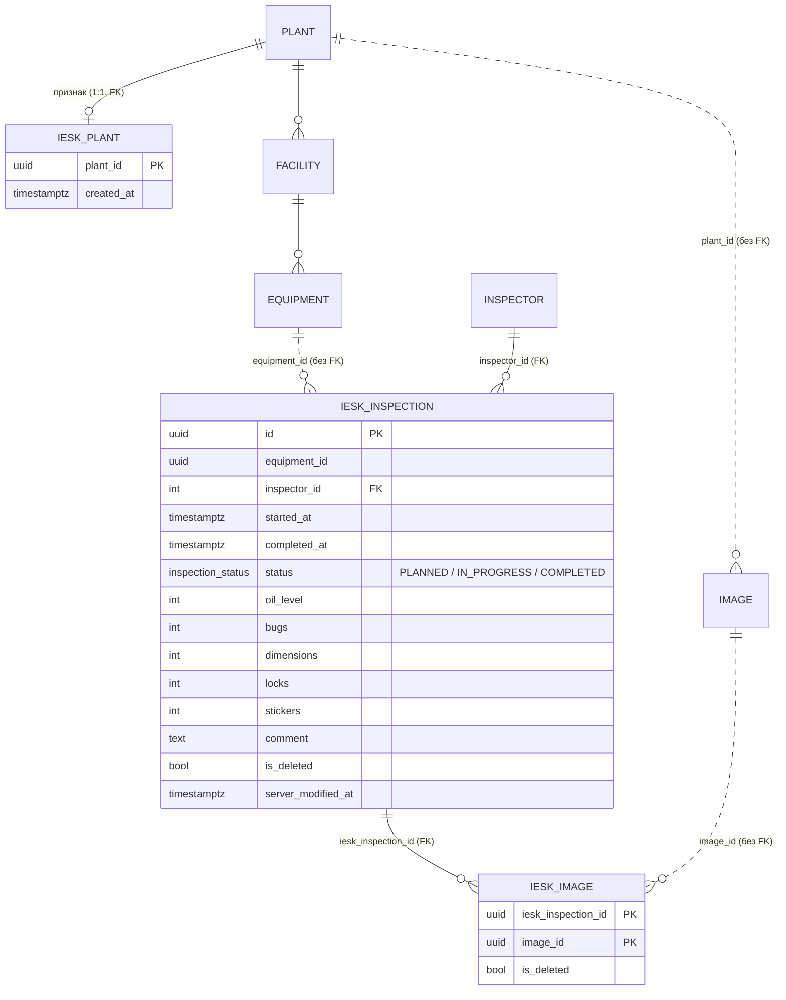
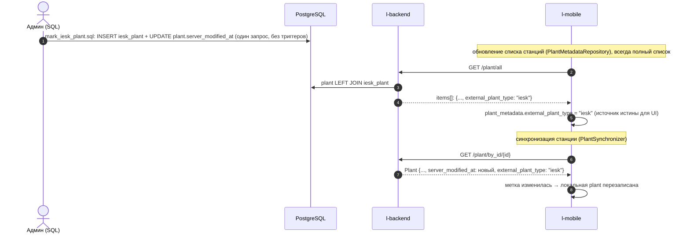
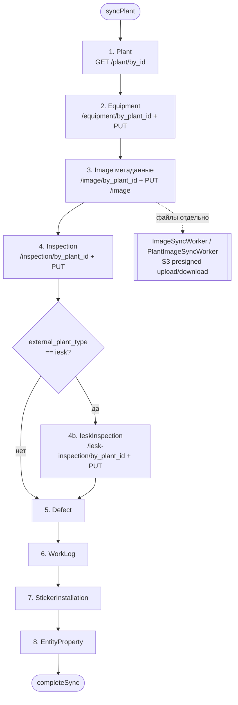
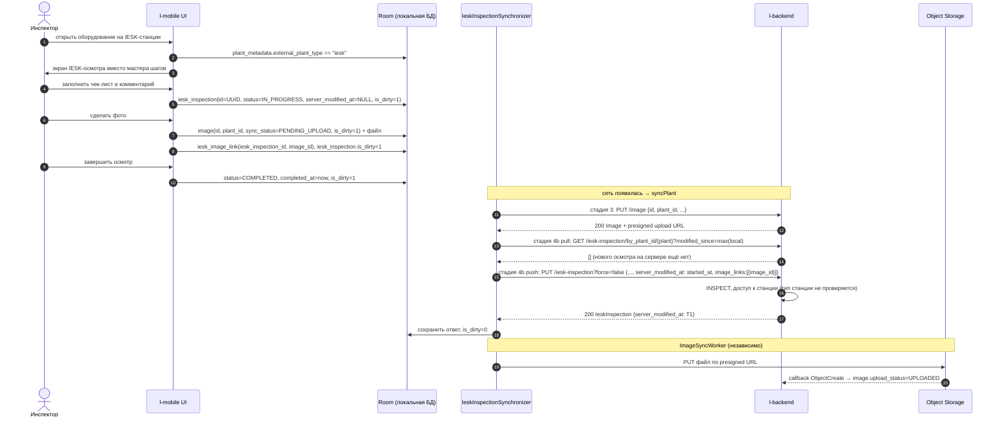
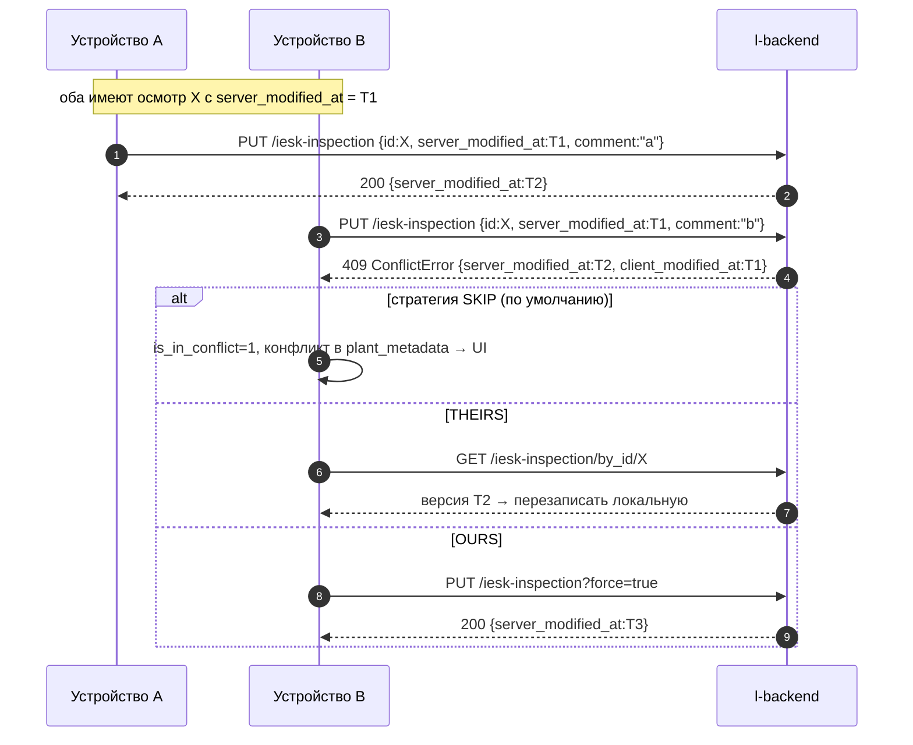

# IESK: схема взаимодействия l-mobile → l-backend

Дополнение к [backend-plan.md](backend-plan.md) и [mobile-implementation.md](mobile-implementation.md). Все схемы — mermaid.

## 1. Модель данных



Агрегаты: **Plant** (+`iesk_plant`), **IeskInspection** (корень + `iesk_image`), **Image** (без изменений, файл в S3).

## 2. Как mobile узнаёт тип станции



Основной канал — шаг 3–5: mobile запрашивает `/plant/all` целиком (`modifiedSince = null`) и перезаписывает поля `plant_metadata` без сравнения меток, поэтому признак доходит, даже если станцию разметили простым `INSERT` без сдвига метки. Сдвиг метки в скрипте разметки нужен только для того, чтобы шаг 9 обновил и локальную копию `plant`.

## 3. Полный цикл синхронизации станции

`BidirectionalPlantSyncCoordinator.syncPlant`: стадии выполняются последовательно, каждая через `BidirSyncAlgorithm` (pull → push при `SKIP`/`THEIRS`, push(force) → pull при `OURS`).



Новая стадия идёт **после Image** (связки ссылаются на уже известные картинки) и **после Equipment** (локальный фильтр по станции идёт через `equipment → facility`).

## 4. Создание IESK-осмотра офлайн и отправка на сервер



## 5. Изменение и удаление (оптимистичная блокировка)



- **Удаление осмотра**: локально `is_deleted=1, is_dirty=1` → PUT с `is_deleted=true`. Другие устройства получают надгробие через `by_plant_id?modified_since`.
- **Удаление фото из осмотра**: локальная связка удаляется, корень становится `is_dirty=1`. PUT без этого `image_id` → сервер ставит связке `is_deleted=true`. При pull mobile отбрасывает связки с `is_deleted=true`.
- **Потерянный ответ** (сервер записал, клиент не получил): повтор PUT → 409. При pull `areEntitiesEqual` сравнивает поля и связки: если всё совпало, ложный конфликт снимается автоматически (`Sync-Principles.md`, раздел про потерянный ответ).

## 6. Контракт API (кратко)

| Метод и путь | Тело / параметры | Ответ | Ошибки |
|---|---|---|---|
| `GET /plant/all` | `modified_since` | `{items:[{..., external_plant_type: "iesk"\|null}]}` | — |
| `GET /plant/by_id/{id}` | — | `Plant {..., external_plant_type}` | 403, 404 |
| `GET /iesk-inspection/by_plant_id/{plant_id}` | `modified_since` | `IeskInspection[]` | 403 |
| `GET /iesk-inspection/by_id/{id}` | — | `IeskInspection` | 403, 404 |
| `GET /iesk-inspection/all` | `modified_since` | `{items: IeskInspectionListItem[]}` | — |
| `PUT /iesk-inspection` | `IeskInspection`, `force` | `IeskInspection` | 400 (нет оборудования / FK), 403, 409, 422 |
| `PUT /image`, `GET /image/...` | без изменений | | |
| `/inspection/*` | без изменений, работает и на IESK-станциях | | |

Пример `IeskInspection`:
```json
{
  "id": "0b6f…",
  "equipment_id": "9a1c…",
  "inspector_id": 7,
  "started_at": "2026-11-19T08:30:00Z",
  "completed_at": "2026-11-19T08:42:00Z",
  "status": "COMPLETED",
  "oil_level": 1,
  "bugs": 0,
  "dimensions": 2,
  "locks": 1,
  "stickers": 3,
  "comment": "Течь масла не обнаружена",
  "is_deleted": false,
  "server_modified_at": "2026-11-19T08:31:12.345Z",
  "image_links": [{"image_id": "c3d2…", "is_deleted": false}]
}
```
